<!-- ============ $ ./perfil.sh ============ -->
<p align="center">
  
</p>

<p align="center">
  <a href="https://www.linkedin.com/in/SEU-USUARIO/"></a>
  <a href="https://SEU-PORTFOLIO"></a>
  
  
</p>

<br/>

<!-- ============ 01. sobre_mim() ============ -->


[;%3E+Java+%2B+Spring+Boot+%E2%98%95;%3E+git+commit+-m+%22evoluindo+sempre%22)](https://git.io/typing-svg)

<div align="justify">

Sou desenvolvedor `Full Stack`, atuando tanto no `Front-end` quanto no `Back-end`, e hoje meu dia a dia está principalmente no **back-end**: construindo a lógica, as APIs e os dados que fazem as aplicações funcionarem de verdade, com **Java e Spring Boot**.
No front e no mobile, trabalho com **React** e **React Native**. Sou estudante de ADS no **Senac PE** e fui aluno destaque na **Residência Tecnológica do Porto Digital**.
Programo em `Java`, `JavaScript`, `Python` e `C#`, e gosto de encarar sistemas complexos e de escala real!
Sou muito curioso, estou sempre aprendendo algo novo e buscando novos desafios na área de tecnologia!

</div>

```diff
+ Construindo back-ends e APIs com Java e Spring Boot
+ Desenvolvendo front-end e mobile com React e React Native
+ Aberto a oportunidades de estágio e júnior
- Bugs (estou trabalhando nisso)
```

<br clear="right"/>
<br/>

<!-- ============ 02. tecnologias() ============ -->

<p align="center">
  
</p>

<br/>

<!-- ============ 03. projetos() ============ -->

<p align="center">
  <a href="https://github.com/VitorrSantoss/Barber-API"><picture><source media="(prefers-color-scheme: dark)" srcset="https://raw.githubusercontent.com/VitorrSantoss/VitorrSantoss/output/repo-1-dark.svg" /><source media="(prefers-color-scheme: light)" srcset="https://raw.githubusercontent.com/VitorrSantoss/VitorrSantoss/output/repo-1.svg" /></picture></a>
  <a href="https://github.com/VitorrSantoss/BBTS-API"><picture><source media="(prefers-color-scheme: dark)" srcset="https://raw.githubusercontent.com/VitorrSantoss/VitorrSantoss/output/repo-2-dark.svg" /><source media="(prefers-color-scheme: light)" srcset="https://raw.githubusercontent.com/VitorrSantoss/VitorrSantoss/output/repo-2.svg" /></picture></a>
</p>

<br/>

<!-- ============ 04. estatisticas() ============ -->

<p align="center">
  <picture><source media="(prefers-color-scheme: dark)" srcset="https://raw.githubusercontent.com/VitorrSantoss/VitorrSantoss/output/stats-dark.svg" /><source media="(prefers-color-scheme: light)" srcset="https://raw.githubusercontent.com/VitorrSantoss/VitorrSantoss/output/stats.svg" /></picture>
  <picture><source media="(prefers-color-scheme: dark)" srcset="https://raw.githubusercontent.com/VitorrSantoss/VitorrSantoss/output/langs-dark.svg" /><source media="(prefers-color-scheme: light)" srcset="https://raw.githubusercontent.com/VitorrSantoss/VitorrSantoss/output/langs.svg" /></picture>
</p>

<p align="center">
  
</p>

<br/>

<!-- ============ 05. contribuicoes() — compilador de contribuições ============ -->

<picture>
  <source media="(prefers-color-scheme: dark)" srcset="https://raw.githubusercontent.com/VitorrSantoss/VitorrSantoss/output/code-contribution-graph-dark.svg" />
  <source media="(prefers-color-scheme: light)" srcset="https://raw.githubusercontent.com/VitorrSantoss/VitorrSantoss/output/code-contribution-graph.svg" />
  
</picture>

<!-- ============ exit ============ -->
<p align="center">
  
</p>
